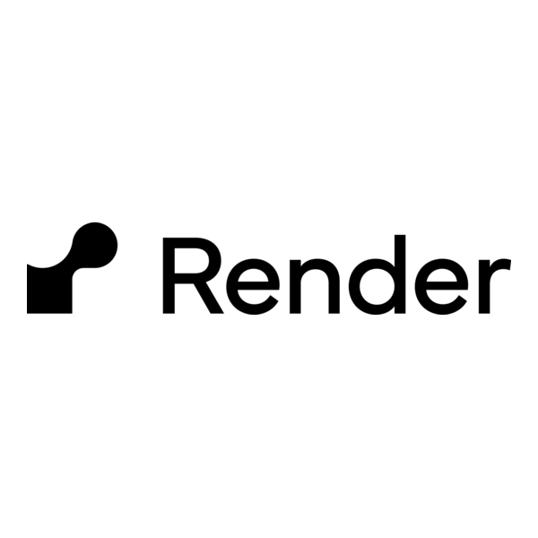
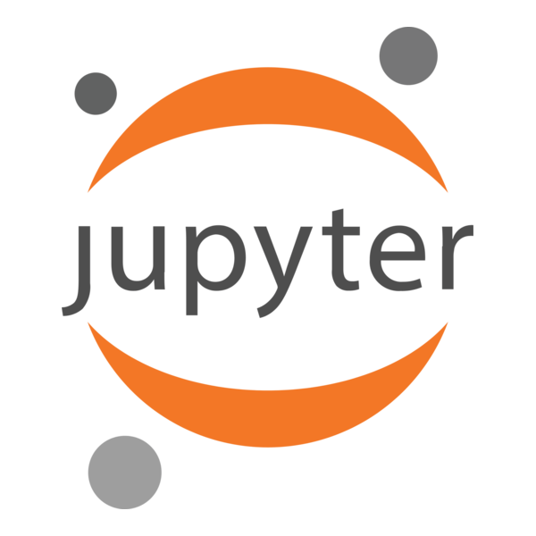
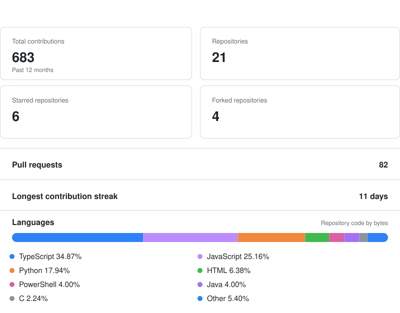

## A Quote

Millions of people within a nation are always necessary for one genius to come into being. Millions of idle human hours must always pass before a truly historical, decisive moment in history makes its appearance. If such a critical moment occurs in the world, it's decisive for decades and centuries. When the strong personal will collided with the historical fate, the sparks flashed, and the moment forever shined in the sky of human civilization. Every such fleeting moment is a stage for heroes. 

Of course, I'm not asking you to be a hero. The world doesn't have that many opportunities to set a stage for heroes. You're a human and only part of humanity. You should know there are limits to what you can do. Don't overestimate or underestimate yourself. Just fulfill your destiny when the time comes. You don't need to shine brilliantly for eternity like a star. You only need to follow your will as best as you can and stick to your belief. Your existence will become the light that illuminates your path, and no matter how dark the night is, it can never hide the glow of a lamp. That would be your light and yours alone.

---

## My Toolkit 

### Languages

  

### Frontend Development

  

### Backend Development

   

### Databases

 

### Mobile & Desktop Development

   

### Cloud, DevOps & Infrastructure

 &nbsp; &nbsp;
  

### Developer Tools & Build Systems

 &nbsp;
  

### Operating Systems

   

### Other Technologies

   

---

## GitHub Analytics

<!-- GITHUB_ANALYTICS:START -->

  

<!-- GITHUB_ANALYTICS:END -->

<!--
**Zaheen-Siddiqui/Zaheen-Siddiqui** is a ✨ _special_ ✨ repository because its `README.md` (this file) appears on your GitHub profile.

Here are some ideas to get you started:

- 🔭 I’m currently working on ...
- 🌱 I’m currently learning ...
- 👯 I’m looking to collaborate on ...
- 🤔 I’m looking for help with ...
- 💬 Ask me about ...
- 📫 How to reach me: ...
- 😄 Pronouns: ...
- ⚡ Fun fact: ...
-->
